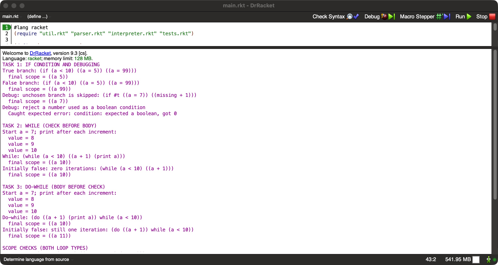
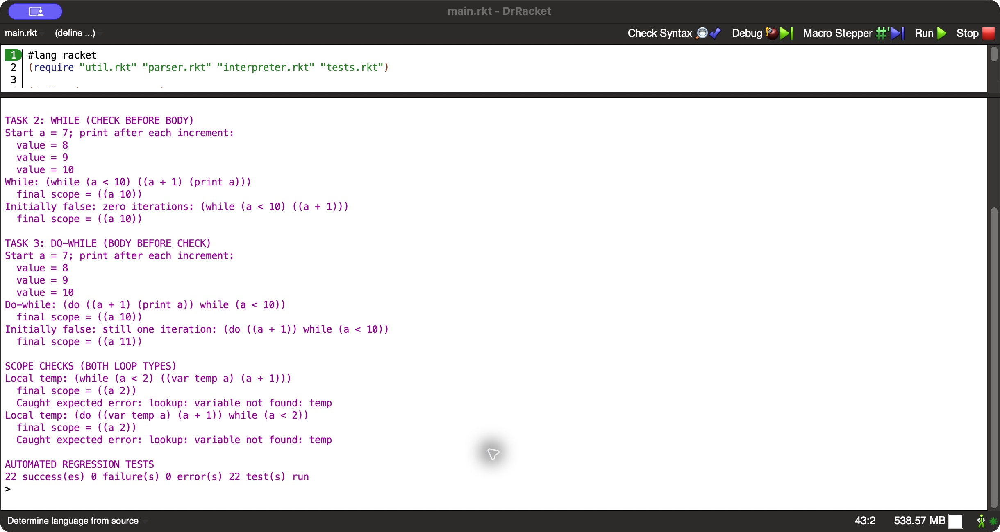
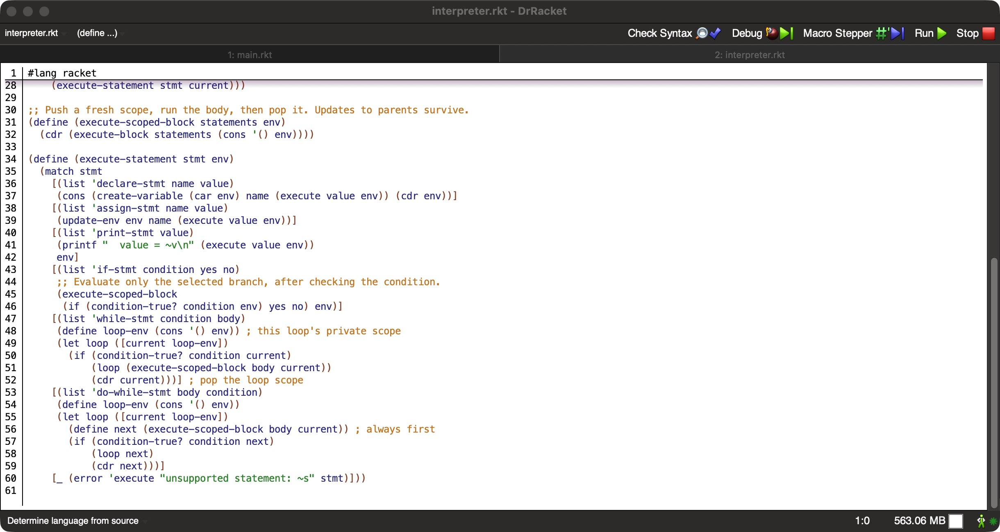

# If, while, and do-while — CSC3210

This assignment extends the previous Racket variable interpreter. The parser
translates quoted source forms into intermediate forms, and the interpreter
executes them using an environment of scopes. Every scope still contains a
list of `(symbol value)` pairs.

## Run

Open **this folder's `main.rkt`** in DrRacket and click **Run**. Keep all five
`.rkt` files together. No additional packages are needed with full Racket.

From a terminal in this folder:

```sh
racket main.rkt
raco test tests.rkt
```

Verified with Racket/DrRacket 9.3: **22 test cases passed, 0 failures, 0 errors**.
The complete printed output is in [console-output.txt](console-output.txt).

## Task 1 — if condition and debugging

```racket
(if (a < 10) ((a = 5)) ((a = 99)))
```

Starting at `a = 1` selects the true branch and produces `a = 5`.
Starting at `a = 12` selects the false branch and produces `a = 99`.
An omitted else branch is an empty block.

Debugging checks demonstrated in `main.rkt`:

- `(if #t ((a = 7)) ((missing + 1)))` succeeds with `a = 7`. This verifies
  that the unselected branch is never executed.
- `(if 0 ((a = 5)) ())` produces a caught `expected a boolean` error.
  Racket normally treats `0` as true; the interpreted language explicitly
  requires `#t` or `#f`. To fix this source example, replace `0` with a
  comparison such as `(a < 10)`.
- Automated tests cover both branches, an omitted else branch, and invalid
  conditions. Test failures raise an error instead of printing a false success.

## Task 2 — while

```racket
(while (a < 10) ((a + 1)))
```

The interpreter checks the condition before executing the body and checks it
again using the updated environment after every iteration. Starting at 7,
`a` becomes 8, 9, then 10. Starting at 10, the body never runs.

## Task 3 — do-while

```racket
(do ((a + 1)) while (a < 10))
```

The body executes before the condition check. Starting at 7, `a` becomes 8,
9, then 10. Starting at 10, the body still executes once, producing 11.
The condition is evaluated using the state after the body has run.

## Syntax and scope decisions

These forms are **quoted input to the custom interpreter**, not native Racket
`while` syntax. For example:

```racket
(execute-statement
 (parse-statement '(while (a < 10) ((a + 1))))
 '(((a 7))))
;; returns '(((a 10)))
```

As agreed for this assignment, `(a + 1)` used as a statement means “update
`a` to `a + 1`.” As an expression, it only computes a value. Explicit assignment
is `(a = expression)`. In a condition, `(a = 10)` compares values. Other
statements include `(var name expression)` and `(print expression)`.

Each loop pushes its own scope and removes it on exit. Each body execution
also has a fresh block scope, allowing a local declaration to be repeated on
each iteration. Body-local declarations are visible to subsequent statements
in that iteration but not to the loop condition or after the loop. A local
name can shadow a parent name. Assignment updates the nearest existing
binding, so updates to an outer counter survive when local scopes are removed.
Undeclared assignments and duplicate declarations in the same scope are errors.

Scope demonstrations run both loop types with `(var temp a)`. Both finish
with only `((a 2))` in the outer scope; looking up `temp` afterward raises a
caught error. Additional tests cover shadowing and nested loops.

## Files and execution evidence

- `util.rkt`: original list-of-pairs design, variable lookup, create, and update.
- `parser.rkt`: source-to-intermediate-form translation.
- `interpreter.rkt`: expressions, scoped blocks, if, while, and do-while.
- `main.rkt`: runnable examples and console demonstrations for all three tasks.
- `tests.rkt`: 22 regression test cases.
- `screenshots/`: actual DrRacket captures of the executed program and code.

### If and while output



### Do-while, scope checks, and test summary



### Control-flow implementation


