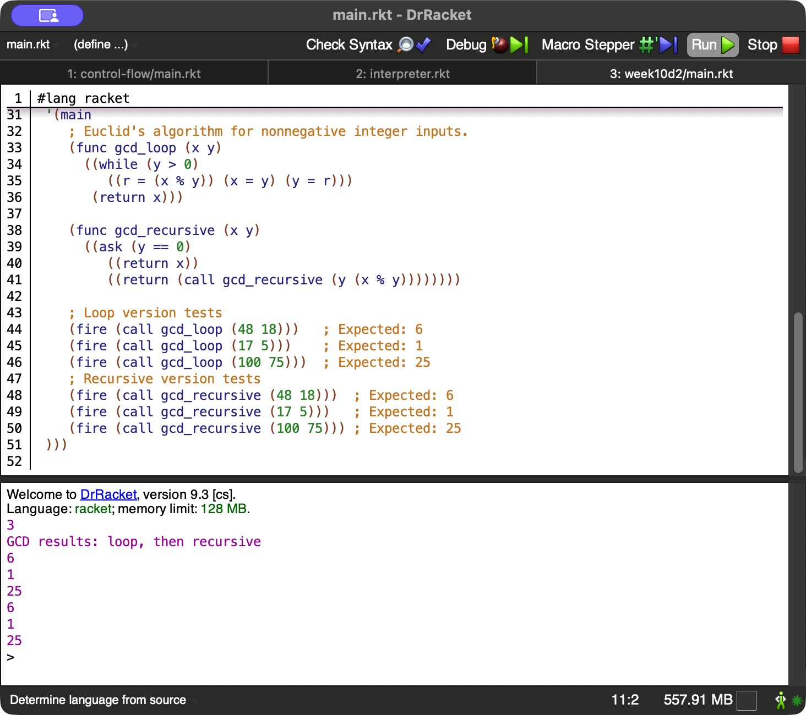

# Greatest Common Divisor in the Class Language

The homework section at the bottom of `main.rkt` implements Euclid's algorithm
with a `while` loop and with a recursive `call`. Both accept nonnegative integers.
The class `parser.rkt`, `interpreter.rkt`, and `util.rkt` are unchanged.

## Run

Open `main.rkt` in DrRacket and click Run, or run:

```sh
racket main.rkt
```

The original `add` example prints `3`. After the GCD heading, the six results are:

| Version | Input | Expected | Actual |
| --- | --- | --- | --- |
| Loop | 48, 18 | 6 | 6 |
| Loop | 17, 5 | 1 | 1 |
| Loop | 100, 75 | 25 | 25 |
| Recursive | 48, 18 | 6 | 6 |
| Recursive | 17, 5 | 1 | 1 |
| Recursive | 100, 75 | 25 | 25 |

Verified with Racket and DrRacket 9.3. The source includes an expected-result
comment next to every `fire` test. [Full console output](console-output.txt).

## Execution screenshot

The capture shows both GCD functions and all six tests with their actual output.



## Class source

[Instructor week10d2 starter](https://github.com/freindst/CSC3210_language_theory_fall_2026/tree/main/week10d2).
The retrieved `main.rkt` includes `add`; it does not contain a `max` example.
