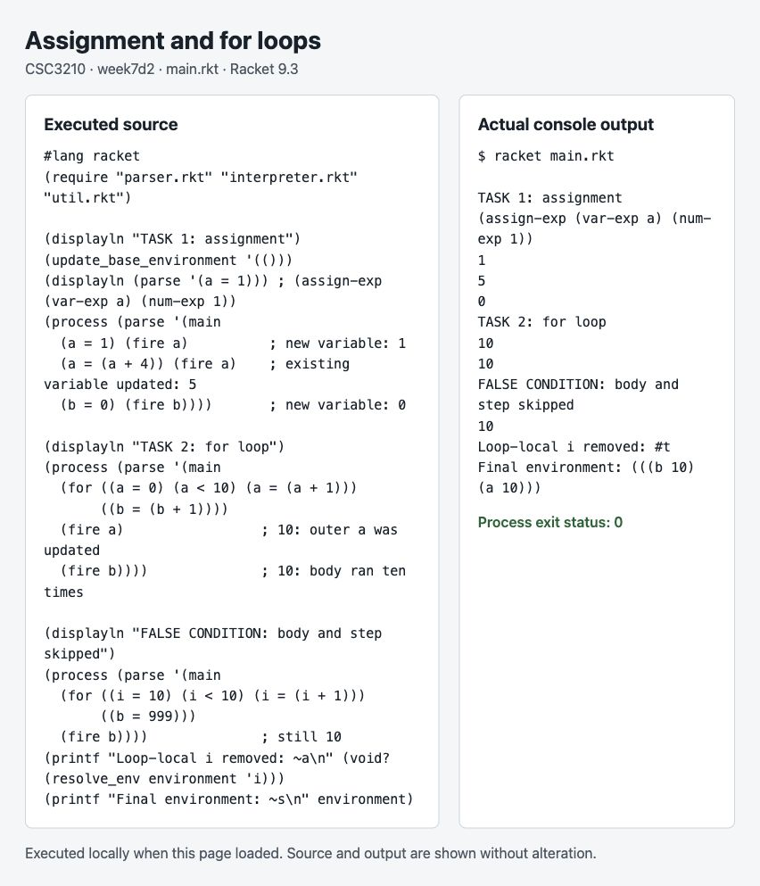
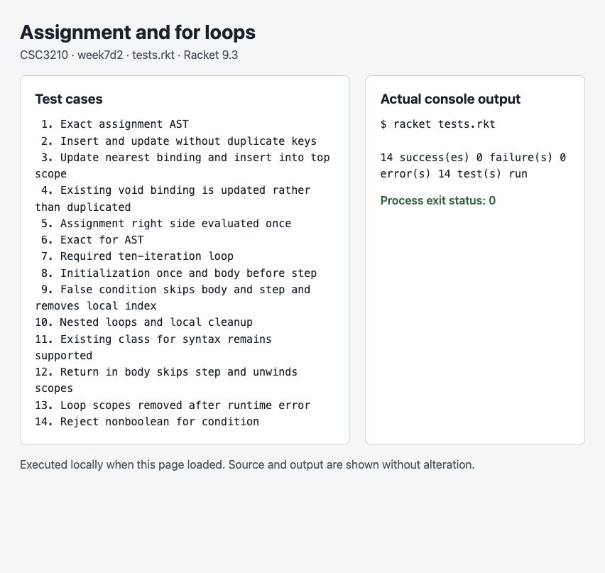

# Week 7 Day 2 — Assignment and for loops

This submission extends the earlier class interpreter while keeping its environment as a list of scopes, each containing `(symbol value)` pairs.

## Run

Open `main.rkt` in DrRacket and click **Run**, or use:

```sh
racket main.rkt
racket tests.rkt
```

## Task 1 — Variable assignment

The parser produces the requested form:

```racket
(parse '(a = 1))
; => (assign-exp (var-exp a) (num-exp 1))
```

`process` evaluates the right-hand expression once, then passes its value and the current environment to `wolf_env`. That utility updates the nearest existing binding; if the name is absent from every scope, it inserts a new pair into the top scope. It checks key presence, so even a binding whose value is `void` counts as existing. Evaluating the right side first preserves any side effects it produces.

## Task 2 — For loop

The assignment's pseudocode is written using the class language's quoted-list syntax:

```racket
(for ((a = 0) (a < 10) (a = (a + 1)))
     ((b = (b + 1))))
```

The three header entries are initialization, condition, and step. Parenthesized statements replace semicolon separators because Racket treats a semicolon as the start of a comment. The parser accepts this list syntax, not a raw C-style text string. Arithmetic expressions on the right side are parenthesized.

The parser creates `(for-exp initialization condition step body)`. The interpreter pushes a loop scope, executes initialization once, and repeats **condition → body → step** while the condition is true. A false first condition skips both the body and step. A fresh inner scope is used for each body execution. Both scopes are removed on exit, including errors; return from a function body skips the step and stops the loop. Existing outer bindings can be updated; new loop-local names disappear afterward.

The prior class form `(for ((a = 0)) (a < 10) ((a = (a + 1))) ((b = (b + 1))))` also remains supported.

## Results

- New assignment: `a = 1`; updating it produces `a = 5`.
- Required for loop: `a = 10`, `b = 10` after ten iterations.
- Initially false condition: `b` remains `10`; local `i` is removed.
- **14 tests passed**, including exact parser forms, nearest-scope updates, single evaluation of the right side, initialization order, nested loops, early return, and scope cleanup after errors.

[Full console output](console-output.txt)

## Actual execution screenshots

These browser captures show a local execution page that invokes Racket and displays the actual process output and exit status. They are not DrRacket captures.





## Files

- `parser.rkt`: assignment and for-expression parsing.
- `interpreter.rkt`: assignment and explicit for-loop execution.
- `util.rkt`: environment lookup, nearest-binding update, and scope operations.
- `main.rkt`: labeled execution examples with expected results.
- `tests.rkt`: 14 automated tests.

Based on the [instructor's class interpreter](https://github.com/freindst/CSC3210_language_theory_fall_2026/tree/main/week10d2) used in the preceding assignment. This folder is independent of the previous submissions.
